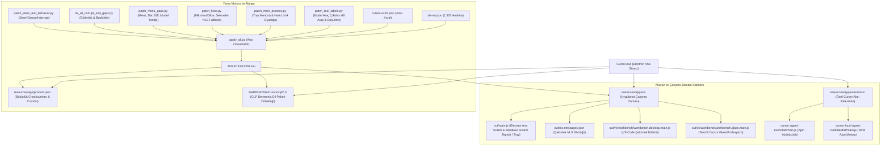
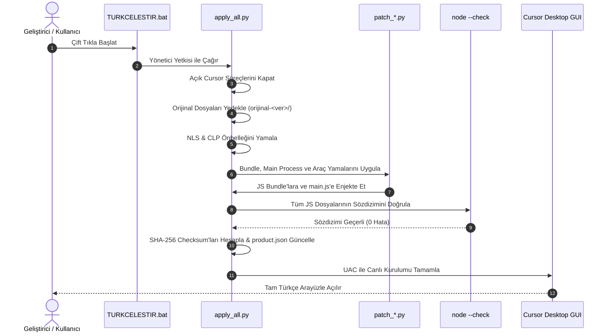

# 🧠 Codebase Memory & Bilgi Grafiği (Knowledge Graph) — Cursor Desktop Türkçe Yerelleştirme ve Mimarî Altyapısı

> **Son Güncelleme:** 2026-10-21  
> **Sürüm:** Cursor Desktop v3.26.13 (Commit: `3bfec373749d3d4a53a151283022d49743ab50b0`)  
> **Konum:** `C:\Users\Work-D\cursor-turkish-localization`  
> **Durum:** Canlıda Aktif & %100 Doğrulanmış (`[OK_VERIFIED]`)  
> **Bütünlük (IntegrityService):** %100 Eşleşme (Bozuk Kurulum Uyarısı Sıfır)

---

## 1. Mimarî Bilgi Grafiği (System Architecture Graph)

---

## 2. Dizinler, Düğümler ve Sorumluluklar

| Düğüm / Dosya | Rol ve İşlev | Enjekte Edilen / Yamalanan Mantık |
| :--- | :--- | :--- |
| **`product.json`** | Cursor sürüm, commit ve bütünlük tablosu | `checksums` anahtarındaki tüm dosyaların SHA-256 Base64 hash'leri yamalı dosyalarla birebir eşitlenir (`IntegrityService` bypass). |
| **`out/main.js`** | Electron Ana Süreci & Windows Sistem Tepsisi | Sağ alt bildirim alanı menüsü (`Tüm Bildirimleri Temizle`, `Cursor'ı Aç`, `Ayarlar`, `Çıkış`, `Son Kullanılan Ajan Yok`) ve harici link onay diyalogları. |
| **`clp\*.tr\...\nls.messages.json`** | Electron'un okuduğu aktif dil önbelleği | Dil paketi seçildiğinde Electron ana `out\nls.messages.json` yerine bu önbelleği okur. Burası senkronize edilmeden üst menüler Türkçeleşmez. |
| **`workbench.desktop.main.js`** | Standart VS Code çekirdek arayüzü | Masaüstü menüleri (`title.value`), boş editör filigranları (`Dosyaya Git`, `Terminali Göster`), git durum çubuğu ve modal pencereler. |
| **`workbench.glass.main.js`** | Cursor'ın tescilli yapay zekâ katmanı | Composer, Chat, Agent Steer/Behavior, Context hapları, model seçicileri, `tool-action-labels.js` eylem sözlüğü ve düşünme durumları. |
| **`patch_tool_labels.py`** | Model araç ve düşünme durumu motoru | 68 araç çağrısının (`shellToolCall`, `readToolCall`, `editToolCall`, vb.) ekrana basılan `{loading, completed, error}` metinleri ile düşünme etiketleri (`Thinking`/`Düşünülüyor`, `Thought`/`Düşündü`). |
| **`patch_main_process.py`** | Ana süreç (Main Process) ve Tray yamalayıcısı | `out/main.js` içindeki Sistem Tepsisi (Tray Menu) öğeleri ve harici link diyalogları. |
| **`patch_fixes.py`** | Bağlamlı tekil düzeltmeler | Mikrofon/Sesli dikte ipuçları (React `<kbd>` yapısına dokunmadan), sekme menüleri, bildirim merkezi NLS fallback'leri. |
| **`patch_menu_gaps.py`** | Menü, dal seçici ve diff kartı motoru | Native Windows menü çubuğu başlıkları (`Dosya`, `Düzen`, `Görünüm`, vb.), dal seçici (`+ Dal Oluştur`), diff kartı (`9 Dosya Değişti`). |
| **`fix_all_corrupt_and_gaps.py`** | Güvenlik ve kritik boşluk giderici | Checksum hesaplama, durum çubuğu kural onarımı ve güncelleyici pencereleri (`Yeni güncelleme mevcut`). |

---

## 3. Çözülen Kritik Mühendislik Problemleri ve Tuzaklar (Gotchas)

### 🚨 1. Electron CLP Önbellek İzolasyonu (The CLP Cache Trap)
* **Problem:** Normal bir VS Code eklentisinde veya yamasında `resources\app\out\nls.messages.json` dosyasını düzenlemek yeterli görünür. Ancak Electron, Türkçe yerel kimliği (`tr-TR` / `tr`) algıladığında Program Files altındaki dosyayı okumayı bırakır ve `%APPDATA%\Cursor\clp\<hash>.tr\<commit>\nls.messages.json` dosyasını belleğe yükler. Eğer bu dosya yamalanmazsa, ana menüler (`File`, `Edit`, `Selection`) inatla İngilizce kalır.
* **Çözüm:** `apply_all.py`, kurulu Cursor commit'ini `product.json` üzerinden anlık okur; aktif CLP önbellek yolunu bularak güncel çevirileri doğrudan bu önbelleğe yazar.

### 🚨 2. IntegrityService ve SHA-256 Base64 Bütünlük Kontrolü
* **Problem:** Cursor başlatılırken `IntegrityService` arka planda çalışır ve `product.json` içerisindeki `checksums` sözlüğünü kontrol eder. Herhangi bir JS veya JSON dosyası 1 bayt bile değişmişse, kullanıcıya *"Your installation appears to be corrupt"* modalı gösterilir ve uzantı eşitlemesi kısıtlanır.
* **Çözüm:** `apply_all.py`, yama işlemi bittikten hemen sonra tüm çıktı dosyalarının ham baytlarını okur, `hashlib.sha256().digest()` alır ve Base64 çıktısını (dolgu `=` karakterleri budanmış olarak) `product.json` dosyasına yazar. Böylece Cursor kendisini orijinal ve kusursuz olarak algılar.

### 🚨 3. Model Araç Çıktıları ve İç Mantık Tuzakları (`tool-action-labels.js`)
* **Problem:** Model çalışırken ekrana basılan durum çıktıları (`Running`, `Reading`, `Editing`, `Thinking`) kodun bazı yerlerinde satır gruplama mantığında (`e.label === "Task"`, `e.label === "Create plan"`, `e.label === "Ask question"`) doğrudan İngilizce string kontrolü ile denetlenir. Eğer genel arama-değiştirme yapılırsa gruplama mantığı çöker ve sohbet arayüzü bozulur.
* **Çözüm:** `patch_tool_labels.py`, `===` kontrollerine ve değişken adlarına hiç dokunmadan yalnızca ekrana render edilen `{loading: "...", completed: "...", error: "..."}` sözlüğünü bağlamlı olarak değiştirir. Böylece iç mantık korunurken ekranda kusursuz Türkçe görünür.

### 🚨 4. Windows Sistem Tepsisi (Tray Menu) ve Electron Ana Süreç İzolasyonu (`out/main.js`)
* **Problem:** Sağ alttaki Windows bildirim alanı simgesine tıklandığında açılan menü (`Clear All Notifications`, `Open Cursor`, `Settings`, `Quit`), renderer bundle'larından değil doğrudan Electron'un Node.js ana sürecinden (`out/main.js`) beslenir. Renderer yamaları bu menüye etki edemez.
* **Çözüm:** `out/main.js` dosyası `apply_all.py` zincirine dahil edildi ve `patch_main_process.py` ile menü yapısı doğrudan ana süreç seviyesinde Türkçeleştirildi.

### 🚨 5. React `<kbd>` Kısayol Bileşenleri ve Şablon Değişkenleri
* **Problem:** Mikrofon ve sesli dikte ipuçlarında (`Click or hold [Ctrl] [M] to dictate`, `Voice Input (${shortcut})`) metinler dinamik değişkenler ve React bileşenleriyle parçalı haldedir. Kısayol şablonlarını körlemesine değiştirmek React çalışma zamanı hatalarına yol açar.
* **Çözüm:** `children:["Click or hold ",` ➔ `children:["Dikte etmek için tıklayın veya ",` ve `," to dictate"]}` ➔ `," tuşuna basılı tutun"]}` şeklinde React DOM ağacına ve değişkenlerine dokunmadan bağlamlı parçalı eşleme yapıldı.

### 🚨 6. Başlık Düzeni (Title Case) ve Yapay Çeviri Önleme Standardı
* **Problem:** Menü ve butonlarda küçük harfli ("Kuyruktan çıkar", "Dosya ekle") veya makine çevirisi yapaylığı taşıyan metinler kullanıcı deneyimini zedeler.
* **Çözüm:** Kullanıcının özel kuralı gereğince tüm menü, buton ve kısa eylem etiketleri Başlık Düzeni (Title Case: `Kuyruktan Çıkar`, `Kuyruğu Kapat`, `Dosya Ekle`, `Bu Makinede Çalıştır`) standardına kavuşturuldu.

---

## 4. Güncelleme ve Dağıtım İş Akışı (Day-0 SLA Pipeline)

---

## 5. Terminoloji ve Dilbilgisi Standartları

* **Bileşen İsimleri:** `Composer`, `Chat`, `Terminal` orijinal korunur ("Besteci" yapılmaz).
* **Git ve SCM Terimleri:** `Branch` -> `Dal`, `Commit` -> `İşleme / İşle`, `Push` -> `Gönder`, `Pull` -> `Çek`, `Diff` -> `Fark`.
* **Başlık Düzeni (Title Case):** Tüm menü ve eylem butonları Türkçe büyük harf kuralına uygundur (`Dosyaya Git`, `Terminali Göster`, `Tarayıcıyı Aç`, `Tüm Bildirimleri Temizle`).
* **Türkçe Çoğul Kuralı:** Sayı belirteçlerinden sonra gelen isimlerde çoğul eki kullanılmaz (`9 Dosya Değişti`, `1 Dosya Değişti`).
